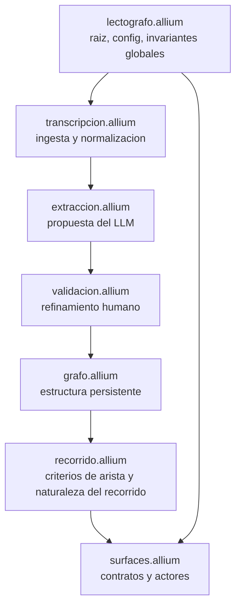
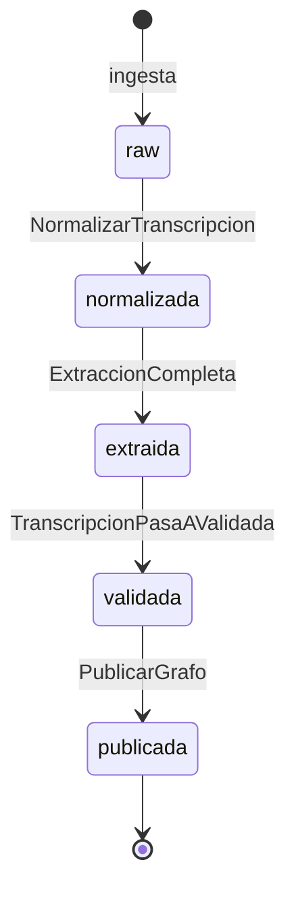

# Specs de Lectógrafo en Allium v3

Esta carpeta contiene la especificacion de comportamiento de Lectógrafo en lenguaje Allium. Allium describe que hace el sistema y bajo que condiciones, sin prescribir como esta implementado [^1].

## Orden de lectura



1. `lectografo.allium` para entender el alcance y la configuracion global.
2. `transcripcion.allium` para el ciclo de vida del texto.
3. `extraccion.allium` para la propuesta cruda del LLM.
4. `validacion.allium` para el flujo de decisiones del investigador.
5. `grafo.allium` para la estructura final persistente.
6. `recorrido.allium` para entender bajo que criterios nace cada arista y que es un recorrido sobre el grafo.
7. `surfaces.allium` para los contratos con los actores (investigador y LLM).

## Ciclo de vida objetivo

El diagrama siguiente expresa el modelo objetivo. En la aplicación alojada los
grafos permanecen en edición y la publicación actual es un enlace de lectura
en vivo, sin exigir validación completa ni crear versiones inmutables. Véase
`multiusuario.allium`: `Publicacion` está implementada; `VersionPublicada` no.



## Como usar estos specs

Hablale al asistente (Claude Code u otro) en lenguaje natural sobre lo que quieres construir o cambiar; el asistente actualiza los `.allium` por ti. Para verificar la sintaxis instala el CLI de Allium [^2] y deja que valide automaticamente.

Las preguntas abiertas (`open question`) son decisiones explicitamente diferidas. No deben resolverse en codigo: hay que cerrarlas primero aqui.

## Colaboración actual

- Quien recibe un texto puede volver a compartirlo con otra cuenta registrada,
  sin límite de eslabones. Todos los permisos apuntan al texto original.
- Los conceptos y relaciones que agrega cualquier colaborador se incorporan
  al mismo grafo. No se crean copias personales del grafo.
- Cada glosa nueva conserva la identidad y el nombre de quien la escribió,
  tomados de la sesión verificada. Todos los colaboradores pueden leerla.
  Las notas anteriores sin identidad se muestran como «Autoría no registrada».
  No hay edición ni borrado individual de glosas en la aplicación actual.
- El menú de los textos recibidos ofrece las mismas acciones que el de los
  propios. La ficha muestra las personas con quienes se ha compartido.
- Las tarjetas muestran un ícono de personas que despliega el listado completo
  de acceso, incluida la persona de la biblioteca original, sin duplicados.
- El menú ⋮ agrupa las acciones de IA después de un separador, bajo
  «Operaciones en el grafo»: procesar, reprocesar, fusionar y simplificar.
  Se retiran los botones de fusión del mapa y de simplificación de Conceptos.
- Todas las tareas con IA muestran su progreso y registro completo en un mismo
  modal, que permanece abierto durante la ejecución y conserva el log al terminar.
  La fusión pasa a revisión de propuestas antes de modificar el grafo.
- La reextracción conserva las glosas con su autoría, las relaciones ocultas
  y el resto del trabajo humano. Un fallo de fusión se informa como error,
  sin sustituir el estado anterior por una extracción nueva.

## Verificación y límites conocidos — 12 de noviembre de 2026

```sh
.venv/bin/python -m unittest discover -s tests -v
node tests/test_frontend.cjs
node tests/test_invitaciones.cjs
node --check static/app.js
allium check specs
allium analyse specs
```

La revisión eliminó los 40 errores estructurales del corpus. `allium check`
con CLI 3.6.0 aún termina con código 1 por advertencias: 28 funciones diferidas
sin ubicación, 8 actores de superficie sin uso, 4 valores descriptivos sin
referencias y 6 avisos sobre `lectografo/config`. Estas últimas referencias
siguen la sintaxis de configuración importada de la referencia del lenguaje;
el CLI instalado las interpreta como nombres de entidades. `allium analyse`
no produce hallazgos de proceso adicionales. Esto no demuestra que los flujos
declarados como objetivos estén implementados.

Persisten estas divergencias, documentadas en los módulos correspondientes:

- Las escrituras concurrentes reescriben el estado completo; gana la última.
- El identificador del texto no es único entre bibliotecas. Una coincidencia
  entre un texto propio y otro compartido puede resolver a bibliotecas
  distintas según la operación. No se ha migrado a `(biblioteca, slug)`.
- La reextracción procesa el archivo original, conserva el texto editado y
  no limpia su marca de desincronización. La extracción dirigida todavía
  puede duplicar un concepto añadido a mano.
- La inferencia la paga el operador, sin contabilidad ni tope en la aplicación.
  Conexiones personales, revocación de permisos y versiones publicadas
  inmutables siguen como objetivos.
- Las sesiones de extracción, reconexión y consolidación en memoria se
  identifican solo por `slug`; no aíslan bibliotecas con identificadores iguales.
- Resetear un grafo borra también su sesión de validación y sus glosas;
  eliminar el texto no retira los permisos ni la publicación.

Estas limitaciones no se han convertido en funciones nuevas durante esta revisión.

## Invitaciones por correo — preparadas, sin activar el envío

El diálogo permite hasta 20 correos por envío, sin exigir una cuenta previa.
Cada persona recibe un mensaje individual con un enlace de 14 días. El servidor
solo concede acceso al autenticar una cuenta con el correo invitado verificado;
el enlace conserva el destino durante el login y abre el texto original.
Los fallos de envío se informan por destinatario. Reabrir una invitación aceptada
con la misma cuenta no duplica el permiso.

Antes de publicar esta función hay que configurar `SMTP_HOST`, `SMTP_PORT`
(465 o 587), `SMTP_USER`, `SMTP_PASSWORD` y `SMTP_FROM` en Cloud Run.
La contraseña debe proceder de Secret Manager. `APP_URL` es el origen público
de la aplicación; nunca se toma del formulario del cliente. Sin configuración,
el servicio informa que el correo no está disponible y no crea invitaciones.
El servicio de correo aún no se ha elegido; no se han enviado mensajes reales.

## Notas al pie

[^1]: La referencia completa del lenguaje vive en `/Users/hspencer/Sites/allium/references/language-reference.md`. El skill principal en `/Users/hspencer/Sites/allium/SKILL.md`.

[^2]: `brew tap juxt/allium && brew install allium` o `cargo install allium-cli`.
